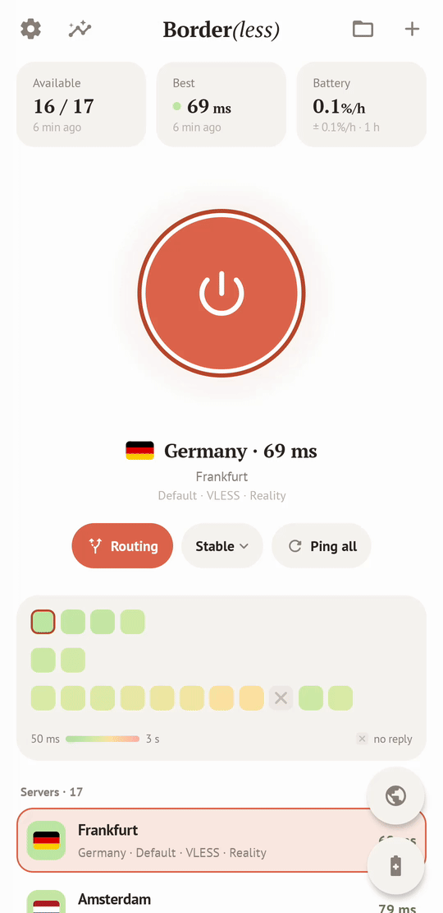
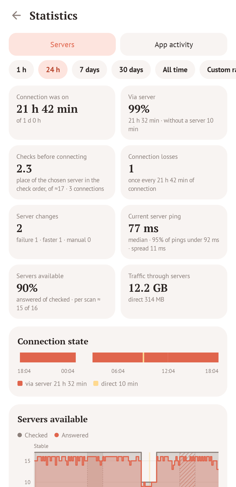
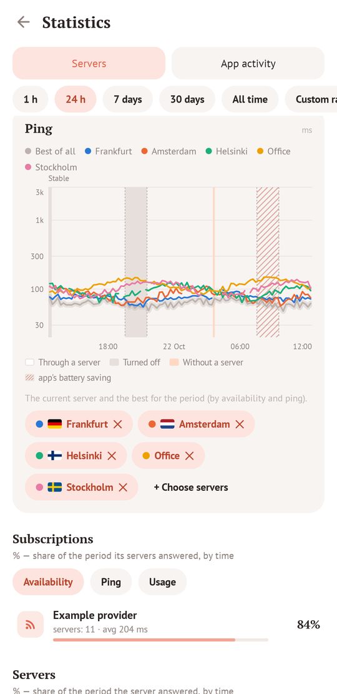
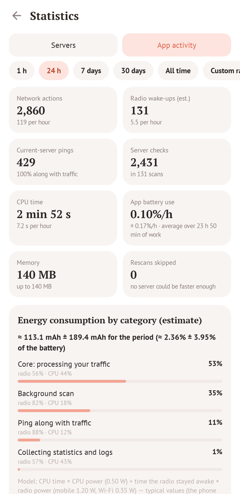
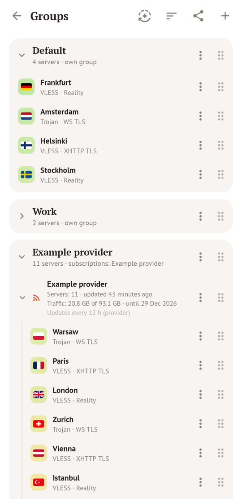
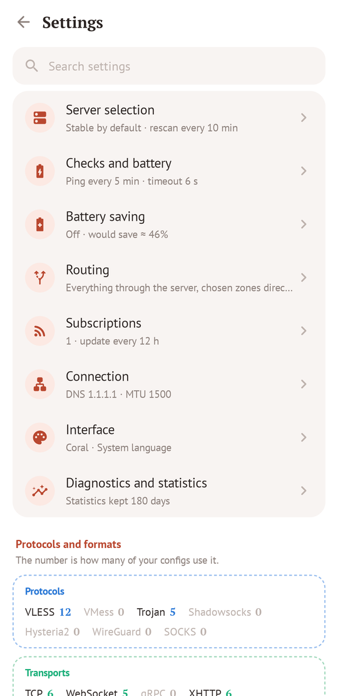

<p align="center">
  <picture>
    <source media="(prefers-color-scheme: dark)" srcset="docs/logo-dark.svg">
    
  </picture>
</p>

<p align="center">
  An Android client for <a href="https://github.com/XTLS/Xray-core">Xray-core</a> that keeps you on a working server by itself<br>
  and is careful with the battery.
</p>

<p align="center">
  <a href="https://github.com/timofeykhodykin/borderless/releases/latest"></a>
  <a href="https://github.com/timofeykhodykin/borderless/releases"></a>
</p>

<p align="center">
  
  
  
  
  <a href="LICENSE"></a>
</p>

<p align="center">
  
  
  
  
  
  
</p>

> Most phones need the `arm64-v8a` APK.

**About this project.** Border(less) is a research proof of concept for one engineering question: *can a phone
keep choosing the best of several network servers continuously while spending as little energy as possible on that
choice?* The app answers it in practice — servers are checked only when a check can pay off, checks ride along with
traffic the phone sends anyway, scans stop as soon as the answer is known, and every decision's cost is measured on
the device itself (CPU time, radio time, battery current) and shown in its statistics. It is a personal technical
experiment, published as is, without any warranty and without any service behind it: it ships no servers and
connects only to the servers its user adds. It is not an advertisement and does not promote any means or ways of
network access: it offers, sells or distributes no servers, subscriptions or access to them, and calls on no one to
use such means. Use it only in line with the laws and the network rules that apply to you.

**On link formats and servers run by others.** Supporting a link format is interoperability, not an endorsement.
Border(less) reads the links its user already has — including `wdtt://` and `qwdtt://` links (WDTT and WDTT Plus) —
and nothing more: it does not create, host, operate, sell or distribute such servers, credentials or access to
them, is not affiliated with WDTT or WDTT Plus, and includes none of their software. Such a link is a set of
credentials for a server run by someone else: using it means trusting that operator and following that service's
rules. Any server you add stays your own choice and responsibility, as does using the app within the law and the
rules of the networks it connects to.

<details>
<summary>О проекте (по-русски)</summary>

Border(less) — исследовательский proof of concept для одного инженерного вопроса: *может ли телефон непрерывно
выбирать лучший из нескольких сетевых серверов, тратя на этот выбор как можно меньше энергии?* Приложение отвечает
на него на практике: серверы проверяются только тогда, когда проверка может окупиться, проверки идут попутно с
трафиком, который телефон и так передаёт, сканирование останавливается, как только ответ найден, а цена каждого
решения измеряется на самом устройстве (время процессора, время работы радиомодуля, ток батареи) и видна в
статистике. Это личный технический эксперимент, опубликованный «как есть», без каких-либо гарантий и без какого-либо
сервиса за ним: в приложении нет своих серверов, оно подключается только к серверам, которые добавил сам
пользователь. Проект не является рекламой и не популяризирует никакие средства и способы доступа к
сети: он не предлагает, не продаёт и не распространяет никаких серверов, подписок или доступа к ним и никого не
призывает ими пользоваться. Используйте его только в соответствии с законами и правилами сетей, которые к вам применимы.

**О форматах ссылок и чужих серверах.** Поддержка формата ссылки — это совместимость, а не одобрение. Border(less)
читает ссылки, которые у пользователя уже есть, — в том числе `wdtt://` и `qwdtt://` (WDTT и WDTT Plus), — и не
более: он не создаёт, не размещает, не обслуживает, не продаёт и не распространяет такие серверы, доступы или
учётные данные, не связан с WDTT и WDTT Plus и не содержит их программ. Такая ссылка — это учётные данные сервера,
которым управляет кто-то другой: пользуясь ею, вы доверяете этому оператору и соблюдаете правила его сервиса. Любой
добавленный сервер остаётся вашим выбором и вашей ответственностью — как и использование приложения в рамках закона
и правил сетей, к которым оно подключается.

</details>

## What it does

**Picks the server for you.** The server in use is watched mostly through its traffic counters, without extra
requests: with the screen on, data going out and nothing coming back for a few seconds is noticed at once. A check
that runs long starts a scan in parallel and probes the current server afresh — if only its connection hung, the
same server is reconnected; otherwise the app moves to the first server that answers (the ones that worked
recently first), after a short wait for a faster one. Servers that keep failing on a network are avoided there for
a while. If none answers, traffic is paused (or goes direct — your choice) and the app keeps retrying; when the
internet itself comes back, it looks for a server at once instead of waiting for its timers. A network change
(Wi-Fi ↔ mobile), the system confirming the network again or the screen turning on are noticed immediately.
After a restart of the phone or an app update the connection comes back by itself if it was on.

**Strategies.** *Stable* moves only to a clearly faster server, *Fastest* chases the best ping, *On failure*
never optimises, *Manual* stays where you put it (and says so when that server stops answering, with a one-tap way
back to automatic choice). Switching the strategy re-chooses the server by its rules. A move to a faster server
waits until the screen turns off, so it never interrupts what you are doing; only a large gain moves sooner, at a
pause in traffic.
*Stable* also weighs each server's kind of connection, read from its configuration: kinds that tend to break
once in use count as slower — XHTTP sending everything in one stream (it can stall on large uploads while pings
still pass), UDP transports, everything in one connection (gRPC, mux), unwrapped Shadowsocks, TLS without a
browser fingerprint. They are still used when nothing better answers.

**Limited network.** When no server answers but the phone still reaches the domain zone's own sites, the app
recognises a limited network: it says so (status, notification, a band on the charts), keeps traffic going
without the tunnel (or paused, as you chose), and checks servers less often — the ones that answered in such a
network every 30 seconds, all of them after 1, 2, then every 5 minutes — instead of draining the battery. It also
keeps track of which of your servers reach out from such a network and prefers those when it connects again. While a
server works there, the zones' sites and apps are tried without the tunnel first and go through the server only
when that way doesn't open (Settings → Routing, on by default).

**Servers of one country.** A globe button limits everything — choice, checks, failover — to the servers of the
countries you pick (by the server's name, else its address); the list can be sorted by name, by how often you
picked a country or by how reliably its servers answer.

**Protocols.** VLESS (Reality, Vision, XHTTP, gRPC, WebSocket, HTTPUpgrade, mKCP), VMess, Trojan, Shadowsocks
(incl. 2022), Hysteria2 (obfs, port hopping), WireGuard, SOCKS5, WDTT links (`wdtt://`, `qwdtt://` — the plain,
WDTT Plus and qwdtt forms; WireGuard carried by them) and any Xray JSON config, including chains through
`dialerProxy`.

**Subscriptions.** base64, plain lists of links or Xray JSON; name, traffic and expiry from the provider's
headers; automatic updates on the provider's schedule. If the provider can't be reached directly, the
subscription is downloaded through one of your servers. Broken links and failed downloads are explained in plain
words. Each provider gets a device id of its own, so providers can't tell they serve the same phone; the phone's
model is sent only if you allow it.

**Groups.** Put servers and whole subscriptions into folders, drag to reorder, hide servers, rename them.
*Auto-visibility* can keep just the servers that work best for you in rotation; *auto-sort* shows them in the order
they are checked.

**Routing.** Ready-made domain zones — a region's sites (in its domains and elsewhere), its network addresses and
the apps that work there only without a tunnel — go direct, everything else through the server; a second mode
sends only the sites on the zones' lists through the server. The app ships no lists: it downloads them on the
first start (until then the zones simply take no part) and keeps them fresh by itself (only the changed categories
are downloaded). It installs only versions of the lists the project has reviewed and signed, and leaves out any
entry that would reach far beyond its zone. Apps you choose work without the tunnel and don't see it. Your own
lists of sites in either direction, an optional ad filter. **Your own zones**: lists of sites, addresses and apps
for either direction, typed in or loaded from a file (plain lists, hosts files, Clash / Surge rules, AdBlock
lists, sing-box rule sets, Xray `.dat` lists); the app shows what of a zone doesn't apply and why.

**Battery saving mode.** One button, or together with the phone's battery saver: checks and rescans become rarer
and smarter, and among working servers the cheaper ones are preferred: by the core's CPU per protocol (measured
on your phone) and by what wakes the radio while the phone is idle (keepalives, health checks). The expected saving
is shown on the button.

**Notification.** None, only while traffic is not going through a server (searching, without a server, no or a
limited network — it can be swiped away), or always.

**Updates.** The app checks for a new release once a day. By default it downloads the update over Wi-Fi and installs
it while the screen is off (Android 12+, once installing from the app is allowed; the connection comes back by
itself); otherwise — or with automatic updates off — a notification offers each new version once. Every download is
checked against the release's checksums and its signature before it is installed.

**Statistics.** Availability and ping of every server, connection states over time (for the whole connection and
for each server and subscription: in use, answering, no reply), failures and switches, traffic, per-subscription
views. A separate tab shows what the app itself does and costs: network actions, CPU
time, an estimate of its battery use with error margins (from the phone's own power profile), and optional real
current measurement. Everything can be exported to CSV.

**Quick Settings and status bar.** A Quick Settings tile that follows the connection live (connecting, server
and ping, direct…; long press opens the app); the notification puts the state icon into the status bar.

**Sharing.** A server, a group, a subscription or everything — as plain links any client understands, or in the
app's own format that also keeps groups and hidden servers. Import by pasting, camera QR or a QR code in a
picture.

**Privacy and security.** App data, logs and statistics are encrypted at rest (AES-GCM / SQLCipher, key in the
Android Keystore); cleartext HTTP is disabled; DNS of the apps in the tunnel goes through the server; servers whose
traffic isn't encrypted or whose certificate isn't checked are marked (and can be left out); "pause traffic" holds
in every case, also with no servers at all; country lookups go through your own servers, never from your address;
automatic checks start one by one rather than all at once, and *Careful checks* limit them to a few servers;
links shared from the app are kept out of screenshots and marked sensitive on the clipboard, and sharing can ask
for the screen lock; logs never contain keys or full subscription URLs, and the detailed log can hide server
addresses when shared; no local proxy is left open for other apps. The core and every build dependency are pinned
by checksum.

## Install

Download the APK for your phone from [Releases](https://github.com/timofeykhodykin/borderless/releases) (almost
always `arm64-v8a`), open it and allow installing from this source. Updates install over the previous version and
keep all your data.

## Build

JDK 17 and the Android SDK (platform 37):

```sh
./gradlew :app:assembleDebug        # app/build/outputs/apk/debug/app-arm64-v8a-debug.apk
./gradlew :app:testDebugUnitTest
```

The core (`libv2ray.aar` from [AndroidLibXrayLite](https://github.com/2dust/AndroidLibXrayLite)) is downloaded on
the first build and checked against the SHA-256 pinned in `app/build.gradle.kts`; Gradle checks every dependency
against `gradle/verification-metadata.xml`. A signed release build needs `keystore.properties` (`storeFile`,
`keyAlias`) in the project root and the passwords there, in `BORDERLESS_STORE_PASSWORD` / `BORDERLESS_KEY_PASSWORD`
or in the macOS Keychain (service `borderless-release`, accounts `store` / `key`). The routing lists are not part
of the build: the app downloads them from the sources named in `app/src/main/assets/regions.json`, as approved in
the signed [`lists/manifest.json`](lists/manifest.json).

## License

Border(less)'s own code: [PolyForm Noncommercial License 1.0.0](LICENSE) — free to use, study, change and share
for any noncommercial purpose; selling it or using it commercially is not allowed
([Russian translation](LICENSE.ru.md)). Components it includes or downloads keep their own licenses (Xray-core MPL-2.0,
libv2ray LGPL-3.0, routing lists GPL-3.0, fonts SIL OFL, and others): see
[THIRD_PARTY_NOTICES.md](THIRD_PARTY_NOTICES.md).
